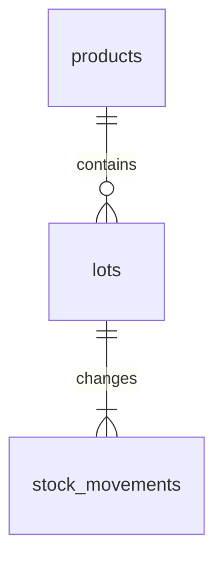

# Từ điển dữ liệu

| Bảng | Một dòng | Trường |
|---|---|---|
| products | Mặt hàng | product_id, name, unit |
| lots | Lô | lot_id, product_id, received_on, expires_on |
| stock_movements | Biến động | movement_id, lot_id, occurred_at, kind, quantity |
| metadata | Thông tin bộ mẫu | key, value |

Tồn vật lý gồm hàng hết hạn còn tồn. Tồn đủ điều kiện dùng cho mô phỏng. Mỗi dòng lượng có đơn vị của mặt hàng.

| Lệnh | Dùng để |
|---|---|
| SELECT, WHERE | Chọn cột, lọc dòng |
| JOIN | Nối theo khóa |
| CASE | Đổi dấu hoặc phân loại |
| GROUP BY, SUM | Tổng hợp về cấp lô |
| SUM OVER | Tính tồn tích lũy mà vẫn giữ từng lô |
